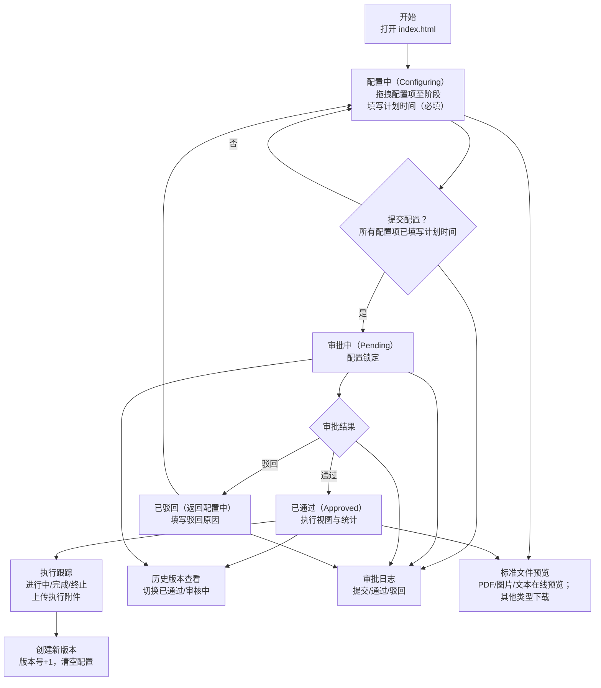

# 交付保障行动项配置系统 · 操作手册

> 版本：V2.1（适用于当前仓库代码）  
> 适用对象：项目经理、质量负责人、实施人员  
> 运行环境：现代浏览器（建议 Chrome / Edge）直接打开 `index.html`

---

## 目录

1. 概述
2. 快速开始
3. 界面总览（含截图占位）
4. 典型使用流程（含截图占位）
5. 版本与审批说明
6. 文件（标准文件/执行附件）管理
7. 常见问题与排错
8. 数据与安全说明
9. 浏览器与兼容性建议
10. 快捷操作与小贴士
11. 术语表
12. 流程图（Mermaid）
附录A. 截图清单与占位说明

---

## 1. 概述

交付保障行动项配置系统用于在项目各阶段（启动、执行、交付）内，通过可视化拖拽方式配置并跟踪行动项，内置审批流程与版本管理，支持标准文件的上传与预览，帮助团队规范交付过程、清晰追踪状态、沉淀最佳实践。

核心能力：
- 拖拽式阶段配置（所见即所得）
- 完整审批流（提交/通过/驳回）
- 版本化管理（历史版本可切换）
- 状态跟踪（进行中/已完成/已终止）
- 标准文件在线预览与下载
- 审批日志留痕

---

## 2. 快速开始

1) 打开项目根目录中的 `index.html`（双击或拖入浏览器）  
2) 首次进入默认处于“配置中（Configuring）”状态  
3) 左侧为“配置项菜单”，右侧为“三个阶段列”，支持拖拽添加

> 数据存储于本地浏览器 LocalStorage。如需清空，可使用右上角“重新开始（仅原型阶段测试使用）”。

---

## 3. 界面总览（含截图占位）

### 3.1 页面总览

> 截图占位：请在 `docs/images/01_页面总览.png` 放置整页截图（顶部工具栏、左侧菜单、右侧阶段区）。

### 3.2 顶部工具栏

包含：系统标题、当前版本、审批日志、历史版本、提交/通过/驳回/新版本/重置等操作。

> 截图占位：请在 `docs/images/02_顶部工具栏.png` 放置顶部工具栏截图，标注主要按钮。

### 3.3 左侧配置项菜单

提供搜索、标签标识、标准文件入口、“管理配置项”按钮（齿轮）。

> 截图占位：`docs/images/03_左侧菜单.png`，建议包含搜索框、若干配置卡片与标签示意。

### 3.4 右侧阶段配置区

三个阶段列（启动/执行/交付），支持拖拽添加、点击卡片打开详情、悬停显示删除。

> 截图占位：`docs/images/04_阶段区域.png`，展示阶段列与卡片序号（#1、#2）。

---

## 4. 典型使用流程（含截图占位）

### 4.1 管理配置项（新增/编辑/禁用与搜索）

路径：左侧“配置菜单” → 右上角齿轮 → 打开“管理配置项”

步骤：
1) 新增：填写“名称/中文名/标签”，可上传标准文件（PDF/Word/Excel/PPT，≤10MB）
2) 编辑：点击列表中的某项进入编辑态，修改后保存
3) 启用/禁用：点击卡片右上操作按钮切换；禁用项会自动从各阶段移除
4) 过滤与搜索：按状态过滤（全部/已启用/已禁用）+ 关键词搜索

> 截图占位：`docs/images/05_管理配置项.png`，标注新增按钮、状态过滤、上传区域。

### 4.2 配置阶段（拖拽与详情设置）

步骤：
1) 从左侧拖拽配置项 → 放入对应阶段列  
2) 自动弹出“配置项详情”对话框，需填写“计划时间”（必填）与备注  
3) 同名项多次添加会显示序号（#1/#2…），删除支持悬停卡片右上“×”

> 截图占位：`docs/images/06_拖拽到阶段.png`、`docs/images/07_配置项详情.png`。

### 4.3 提交审批

前置检查：所有阶段中的每个配置项均已填写“计划时间”。

步骤：
1) 点击顶部“提交配置”  
2) 确认提示后进入“审批中（Pending）”，配置将被锁定

> 截图占位：`docs/images/08_提交审批.png`，展示提交按钮与提示。

### 4.4 审批（通过/驳回）

审批视角：
- 通过：进入“已通过（Approved）”视图，展示三栏数据与统计
- 驳回：需填写驳回原因；系统返回“配置中”，保留原始配置以便修改

> 截图占位：`docs/images/09_审批通过视图.png`、`docs/images/10_审批驳回.png`。

### 4.5 版本管理

- 创建新版本：已通过后，点击“创建新版本”，当前配置清空，版本号+1，进入配置中
- 历史版本：点击“历史版本”，选择带“审核中/已通过”标签的版本可切换查看

> 截图占位：`docs/images/11_版本管理.png`，标注历史版本下拉与标签。

### 4.6 文件（标准文件/执行附件）

- 标准文件：在配置项卡片或详情中点击文件图标/链接 → 打开文件预览对话框（PDF/图片/文本支持在线预览）
- 下载：预览窗内支持一键下载
- 执行附件：审批通过后，在详情中“相关附件”区域可跳转到上传页面（示例提示）

> 截图占位：`docs/images/12_标准文件预览.png`，展示PDF预览器与工具栏。

### 4.7 审批日志

路径：顶部“审批日志” → 打开日志列表，支持倒序查看“提交/通过/驳回”等记录。

> 截图占位：`docs/images/13_审批日志.png`。

### 4.8 重置与重新开始（谨慎）

- 重置配置：清空三个阶段的当前配置，不影响版本历史
- 重新开始：清空所有本地数据（含版本、日志等），仅原型阶段测试使用

> 截图占位：`docs/images/14_重置与重新开始.png`，标注“重新开始”菜单项（红色提醒）。

### 4.9 审批通过后：状态更新与管理（含截图占位）

审批通过后，系统进入“执行视图”。此时各阶段会展示统计信息，单条配置项进入“执行管理”模式：

- 可执行操作（进行中状态下）：
  - 保存更改：可编辑“计划时间”和“备注描述”并保存
  - 标记完成：点击后自动写入“完成日期（当天）”，并进入只读态
  - 标记终止：点击后自动写入“终止日期（当天）”，并进入只读态
- 不可执行操作：
  - 已完成/已终止的项不可再次修改（只读展示）
  - 审批通过后不支持从界面删除配置项（保障可追溯性）
- 文件与证据：
  - “标准文件”在详情中可直接查看/下载
  - “相关附件”提供上传入口（当前为示例跳转按钮，可按实际系统替换URL）

操作路径：
1) 审批通过后，页面自动切换到“执行视图”并显示阶段统计
2) 点击任一配置项 → 打开“配置详情”对话框
3) 在“进行中”状态下，可编辑“计划时间/备注描述”，或点击“标记完成/标记终止”
4) 标记后该项进入只读态；可在列表中看到状态图标与“完成/终止日期”

界面要点对应关系：
- 阶段统计：总计/完成/进行/终止
- 状态展示：进行中（钟表图标）、已完成（对勾）、已终止（叉号）
- 只读规则：已完成/已终止 → 详情面板不可编辑

> 截图占位：
> - `docs/images/15_执行视图_阶段统计.png`（顶部为某阶段卡片统计区域）
> - `docs/images/16_状态更新面板.png`（“配置详情”对话框中状态/计划时间/备注/标准文件/相关附件）
> - `docs/images/17_标记完成_终止.png`（进行中状态下底部“标记完成/标记终止”按钮示意）

---

## 5. 版本与审批说明

- 草稿版本号：在“配置中”阶段展示为 `currentDraftVersion`（如 V2），提交后才形成历史版本记录
- 审批中：配置锁定，仅可查看；历史版本列表会显示“审核中”标记
- 审批通过：当前版本标记为“已通过”，布局切换为执行视图，可更新执行状态与记录时间
- 审批驳回：记录驳回原因并返回“配置中”，原配置保留，便于修改后再次提交

---

## 6. 文件（标准文件/执行附件）管理

- 支持类型：PDF、Word、Excel、PPT；单文件≤10MB
- 预览支持：PDF/图片/文本在线预览；其他类型提示下载
- 安全校验：上传时校验格式与大小；错误会提示并阻止进入列表
- 文件来源：
  - 标准文件：配置项维度的规范/模板/参考资料
  - 执行附件：执行阶段产生的证据/记录文件

---

## 7. 常见问题与排错

1) 提交按钮置灰？
- 需确保：三个阶段合计>0 条配置项，且每一条都已填写“计划时间”。

2) 拖拽后未出现详情弹窗？
- 检查是否被浏览器拦截弹窗；或刷新页面后重试。

3) 文件无法预览？
- 非支持的在线预览类型（Word/Excel/PPT）请直接下载查看；PDF/图片/文本仍异常时检查是否为损坏文件。

4) 历史版本中看不到最新修改？
- 只有“提交后”的版本才会写入历史；“配置中”的草稿不会进入历史列表。

5) 误操作清除了数据？
- 本系统数据存于浏览器本地，确需恢复请避免清理浏览器数据；重要配置建议导出为截图或另行记录。

---

## 8. 数据与安全说明

- 存储位置：浏览器 LocalStorage（键名：`projectConfig`）
- 清理影响：清空浏览器站点数据会导致所有记录丢失
- 权限提示：当前版本为单机本地原型，无登录与鉴权；多人协作/服务端存储需扩展后端能力

---

## 9. 浏览器与兼容性建议

- 建议使用最新的 Chrome / Edge / Firefox  
- 需启用本地存储与弹窗/下载权限  
- 屏幕分辨率建议 ≥ 1440×900，以获得更佳三栏视图体验

---

## 10. 快捷操作与小贴士

- 左侧搜索可按英文名称或标签命中
- 同名项多次添加会自动编号（#1/#2…），便于区分批次/轮次
- 审批通过后不建议再频繁改版；如需重大调整，先“创建新版本”再配置

---

## 11. 术语表

- 配置项：交付保障行动项（如“质量审计”“可施工性评审”等）
- 标准文件：与配置项关联的模板/规范/指引资料
- 执行附件：执行阶段上传的证明性材料（记录、报告、签署件等）
- 版本：一次完整配置提交并审批形成的基线

---

## 12. 流程图（Mermaid）

> 说明：可在支持 Mermaid 的 Markdown 阅读器中直接渲染（如 VSCode + Mermaid 插件、Typora、Obsidian 等）。

---

## 附录A. 截图清单与占位说明

- [ ] 01_页面总览.png（首页完整视图）
- [ ] 02_顶部工具栏.png（按钮标注）
- [ ] 03_左侧菜单.png（搜索与标签）
- [ ] 04_阶段区域.png（阶段列与卡片序号）
- [ ] 05_管理配置项.png（新增/编辑/过滤/上传）
- [ ] 06_拖拽到阶段.png（拖拽过程）
- [ ] 07_配置项详情.png（计划时间必填）
- [ ] 08_提交审批.png（提交确认）
- [ ] 09_审批通过视图.png（三栏统计）
- [ ] 10_审批驳回.png（驳回原因）
- [ ] 11_版本管理.png（历史版本下拉与标签）
- [ ] 12_标准文件预览.png（PDF预览对话框）
- [ ] 13_审批日志.png（日志列表）
- [ ] 14_重置与重新开始.png（高风险操作提醒）
- [ ] 15_执行视图_阶段统计.png（审批通过后的阶段统计）
- [ ] 16_状态更新面板.png（审批通过后的详情面板）
- [ ] 17_标记完成_终止.png（执行态的状态操作按钮）

目录建议：将实际截图放置于 `docs/images/` 目录，文件名保持与上表一致，便于文档引用与维护。

